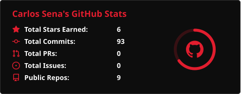
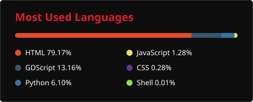

<h1>Carlos Sena</h1>

---

### Languages and Tools

---

### About Me

Software developer with hands-on experience building data automation pipelines and Power BI dashboards for commercial performance tracking at GOL Linhas Aéreas, consolidating sales data and KPIs across systems handling large daily volumes.

Skilled in Python, Java, JavaScript, SQL, React, C and PHP with practical exposure to Azure Databricks, and AWS cloud environments.

Currently developing Yuno, a personal AI and automation platform exploring service integration, modular architecture, and applied AI, while completing a degree in Software Analysis & Development.

---

### GitHub Statistics

